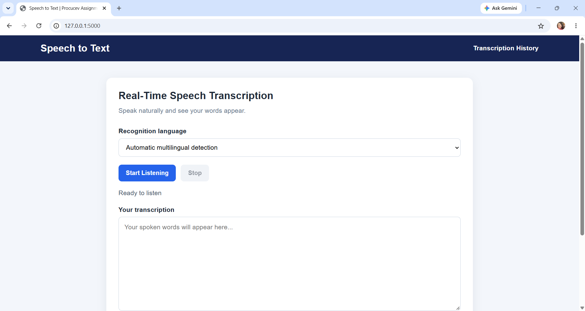
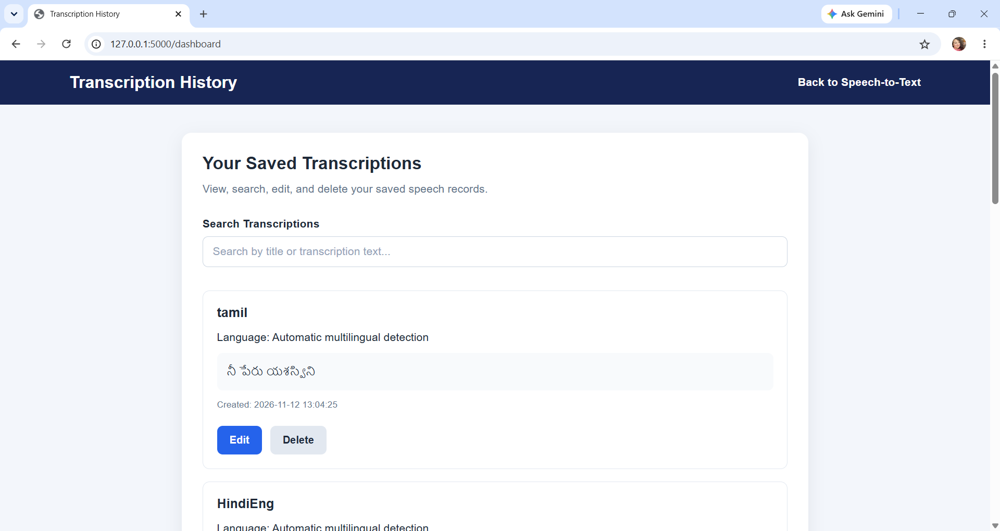
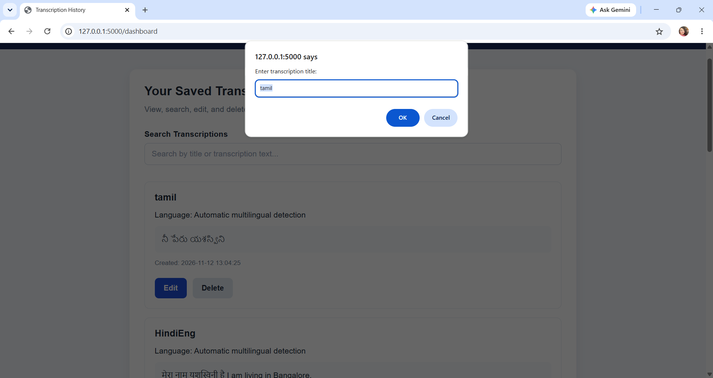

# AI Speech-to-Text Application

A real-time multilingual Speech-to-Text web application that converts spoken audio into text using Chariot ASR. The application supports automatic language detection, live transcription, and transcription history management.

## Project Overview

The AI Speech-to-Text application allows users to record their voice through a microphone and receive real-time text transcription. It uses a Flask backend to communicate with the Chariot ASR WebSocket API and MySQL to store and manage transcription records.

Users can save, view, search, update, and delete their previous transcriptions.

## Key Features

- Real-time speech-to-text conversion.
- Automatic multilingual language detection.
- Support for English, Hindi, and code-mixed speech.
- Live transcription through WebSocket communication.
- Microphone recording with Start and Stop controls.
- No-speech detection and error handling.
- Save transcriptions with custom titles.
- Transcription history dashboard.
- Search previous transcriptions.
- Edit and delete saved records.
- MySQL database integration.

## Technologies Used

| Category | Technologies |
|---|---|
| Frontend | HTML, CSS, JavaScript |
| Backend | Python, Flask |
| Database | MySQL |
| Speech Recognition | Chariot ASR API |
| Communication | WebSocket |
| Development Tools | VS Code, MySQL Workbench, Git, GitHub |

## Project Structure

```text
ai-speech-to-text/
│
├── static/
│   ├── css/
│   │   └── style.css
│   │
│   └── js/
│       ├── script.js
│       └── dashboard.js
│
├── templates/
│   ├── index.html
│   └── dashboard.html
│
├── app.py
├── test_asr.py
├── requirements.txt
├── .gitignore
└── README.md
```

## System Architecture

1. The user opens the web application and grants microphone permission.
2. JavaScript captures microphone audio and converts it into PCM audio data.
3. Audio data is streamed to the Flask backend through WebSocket communication.
4. Flask forwards the audio to the Chariot ASR real-time API.
5. Chariot processes the audio and returns transcription events.
6. Flask forwards the transcription results to the browser.
7. The user can save the completed transcription in the MySQL database.
8. The dashboard provides options to view, search, update, and delete saved transcriptions.

## Database Configuration

Create a MySQL database:

```sql
CREATE DATABASE speech_to_text_db;
```

Select the database:

```sql
USE speech_to_text_db;
```

Create the transcriptions table:

```sql
CREATE TABLE transcriptions (
    id INT AUTO_INCREMENT PRIMARY KEY,
    title VARCHAR(150) DEFAULT 'Untitled Transcription',
    transcript TEXT NOT NULL,
    language VARCHAR(100) DEFAULT 'Unknown',
    created_at TIMESTAMP DEFAULT CURRENT_TIMESTAMP,
    updated_at TIMESTAMP DEFAULT CURRENT_TIMESTAMP
        ON UPDATE CURRENT_TIMESTAMP
);
```

## Installation and Setup

### 1. Clone the Repository

```bash
git clone https://github.com/YashaswiniNK14/ai-speech-to-text.git
```

### 2. Navigate to the Project Directory

```bash
cd ai-speech-to-text
```

### 3. Create a Virtual Environment

```bash
python -m venv venv
```

Activate it on Windows:

```powershell
venv\Scripts\activate
```

### 4. Install Dependencies

```bash
pip install -r requirements.txt
```

### 5. Configure Environment Variables

Create a `.env` file in the root directory.

Add the following configuration with your own credentials:

```env
CHARIOT_API_KEY=your_chariot_api_key

DB_HOST=localhost
DB_USER=your_mysql_username
DB_PASSWORD=your_mysql_password
DB_NAME=speech_to_text_db

ASR_MODE=balanced
ASR_STYLE=codemix
```

**Important:** Never upload your `.env` file or expose your API key publicly.

### 6. Start the Application

```bash
python app.py
```

Open your browser and visit:

```text
http://127.0.0.1:5000/
```


## Application Screenshots

### Home Page - Real-Time Speech Transcription



### Transcription History Dashboard



### Edit Transcription




## Application Modules

### 1. Real-Time Speech Transcription

Allows users to record their voice and receive live multilingual transcription.

### 2. Transcription Management

Users can save completed transcriptions with titles and view their saved records.

### 3. Transcription History Dashboard

Displays previously saved transcriptions and provides search, edit, and delete functionality.

### 4. Database Connectivity

MySQL stores transcription details, including titles, recognized text, language information, and timestamps.

## API Endpoints

| HTTP Method | Endpoint | Description |
|---|---|---|
| POST | `/api/transcriptions` | Save a transcription |
| GET | `/api/transcriptions` | Retrieve all transcriptions |
| GET | `/api/transcriptions/<id>` | Retrieve a specific transcription |
| PUT | `/api/transcriptions/<id>` | Update a transcription |
| DELETE | `/api/transcriptions/<id>` | Delete a transcription |
| GET | `/test-db` | Test MySQL connectivity |

## Testing

The application was tested for:

- Microphone access and audio streaming.
- English and Hindi speech recognition.
- Mixed-language speech recognition.
- Automatic multilingual detection.
- Empty audio and no-speech handling.
- Repeated recording sessions.
- Saving and retrieving transcriptions.
- Editing and deleting records.
- Searching transcription history.
- WebSocket connection and communication.

## Future Enhancements

- Support for additional regional and international languages.
- Export transcriptions as PDF and TXT files.
- Audio recording history.
- User authentication and personalized dashboards.
- Improved transcription analytics.

## Author

**Yashaswini N K**

MCA Graduate 

GitHub: [YashaswiniNK14](https://github.com/YashaswiniNK14)

---

*Developed as part of the Procucev AI Tech Hiring Assignment.*